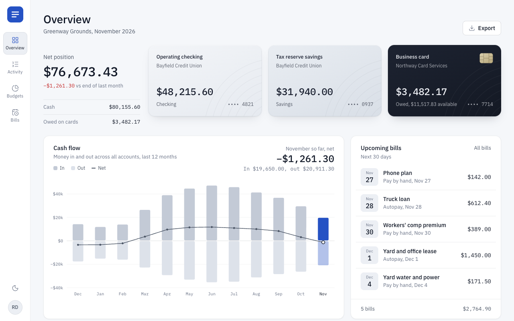

# Fieldbook: finance dashboard template

A free React finance dashboard for a small business or a household: account balances, cash flow, transactions, budgets and recurring bills. Static, fast and easy to make your own.



[](https://console.cloudzyro.com/new?repo=https://github.com/Cloudzyro/template-finance-dashboard)

## What's included

- Overview: net position, each account drawn as its bank or credit card, a 12 month cash flow chart (money in above the line, money out below, net as a line, hover or tab for details), upcoming bills and recent transactions
- Activity: every transaction grouped by day, with search, category and account filters, totals for what's shown, and the category editable inline
- Budgets: a monthly limit per category with progress bars, a marker for where spending would be if it ran evenly, over-budget states and editable limits
- Bills: a 30 day calendar strip, recurring bills with due dates, autopay status and a Mark paid action, and totals for the month ahead
- Changes (categories, limits, paid bills) are kept in the browser with localStorage, so the demo feels real without a backend
- Charts drawn in plain SVG (no chart library), with a hidden data table for screen readers
- Light and dark themes, an icon rail on desktop and a bottom tab bar on phones
- Hash routing, so every page and deep link works on any static host
- Accessible: labeled controls, visible focus, skip link, reduced motion respected

## Run it locally

```bash
pnpm install
pnpm dev        # http://localhost:5173
pnpm build      # static site in dist/
pnpm preview    # serve the built site
```

## Make it yours

- **Accounts, transactions, budgets, bills and the cash flow history:** everything lives in `src/data/finance.ts`. Replace the sample arrays with calls to your own API or bank feed when you're ready.
- **Today's date:** the sample data treats November 25, 2026 as today (`app.today` in the same file), so it always looks current. Set it to `null` to use the real date.
- **Saved changes:** `src/lib/store.ts` keeps edits in localStorage. Swap those hooks for your API to save them for real.
- **Colors:** edit the CSS variables at the top of `src/index.css` (`:root` for light, `:root.dark` for dark). The accent is `--accent`; the account card materials are the `--card-*` variables.
- **Fonts:** IBM Plex Sans and IBM Plex Mono are self-hosted through Fontsource and imported at the top of `src/index.css`.
- **Pages:** add a page in `src/pages/`, a route in `src/main.tsx` and a link in `src/components/Layout.tsx`.
- **Social card:** replace `public/og-image.png` (1200x630).

Optional build-time variables:

| Variable | What it does |
| --- | --- |
| `VITE_SITE_URL` | Your public address, used for the social card and sitemap |
| `VITE_ALLOW_INDEXING` | Set to `true` to let search engines index the site. Off by default, since finance dashboards are usually private |

This template has no sign-in. Before you connect real accounts, put it behind your own auth (for example Supabase Auth, Clerk or your host's access controls).

## Routing on static hosts

The app uses React Router's hash router, so addresses look like `/#/budgets`. The part after `#` never reaches the server, which only ever sends `index.html`, so deep links and refreshes work on nginx, Cloudzyro, GitHub Pages, S3 or any static host with no rewrite rules. The build also writes `dist/404.html`, so a mistyped path still opens the app.

## Deploy

Click the **Deploy to Cloudzyro** button above, or push your own copy to GitHub and connect it in the Cloudzyro console. The build command is `pnpm build` and the output folder is `dist`. No server is needed.

## Stack

- [React](https://react.dev) 19 and [React Router](https://reactrouter.com) 8
- [Vite](https://vite.dev) 8
- Plain CSS with custom properties (no CSS framework)
- [Lucide](https://lucide.dev) icons
- TypeScript

## License

MIT, see [LICENSE](./LICENSE).
